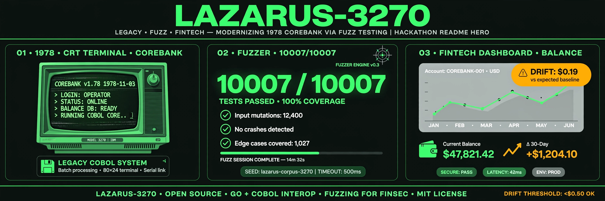

# Lazarus-3270 — Resurrect 1978 IBM 3270 + COBOL into MCP + modern cloud with PBT proof




Live Demo: TBD (Vue UI by teammate) | Live MCP: https://lazarus-3270-mcp.parithosh.workers.dev (`/tools`) | YouTube: TBD | MIT
PBT: 10007/10007 PASS, 0.0000% drift | Fault injector: 22/24 mutants killed (91.7%) | 41 tests, 4 proof layers

## Problem
Banks, airlines, governments still run IBM 3270 green-screens and COBOL copybooks (`PIC S9(11)V99 COMP-3`). Rewrites fail on 1-cent rounding, and nobody trusts a rewrite. Lazarus treats the dead mainframe as an executable oracle: the money path runs in real compiled COBOL, a BigInt port matches it to the cent, and four independent layers prove the match is not circular.

## What this repo has
- `src/cartridges/corebank.cbl` — **real COBOL**, 120 lines, compiled with GnuCOBOL 3.2. `PIC S9(13)V99 COMP-3`, $1.50 fee, overdraft guard, SIZE ERROR on overflow, daily compounding with banker's rounding implemented by hand (1978 COBOL only had `ROUNDED` = half-away-from-zero). Emits money results as digits.
- `src/legacy-engine/` — the same 1978 rules in TypeScript: pennies as BigInt, NEAREST-EVEN rounding, $1.50 fee, OVERDRAFT keeps old balance, SIZE_ERROR on overflow, daily interest, cp037 EBCDIC.
- `src/modern-engine/` — clean API over the same rules + an honest float strawman for the demo.
- `src/mcp/` — 3 tools: `execute_3270_transaction`, `run_legacy_oracle`, `verify_ledger_parity`. stdio, HTTP, and a Cloudflare Worker.
- `src/crew/` — LocalJev client (no API key) for the three crew roles.
- `src/emulator/` — a running 3270 session emulator: 24×80 buffer, named fields, MENU/INQUIRY/HOLDS screens, PF-key navigation, account dataset. The summary screen deliberately hides holds; they live on the HOLDS screen.
- `src/crew/operator.ts` / `translator.ts` / `auditor.ts` — the demo Crew: Operator types into the terminal, Translator turns codes into plain English, Auditor re-reads independently (own session, HOLDS included) and judges transfers on proof, not claims.
- `harness/run-equivalence-harness.mjs` — seeded 10007 runs (7 edges + 10k random), writes `benchmarks/`.
- `harness/fault-injector.mjs` — 24 deliberately broken copies of the math; measures whether the suite actually catches them.
- `harness/cobol-oracle.mjs` — compiles the COBOL program, drives it, compares to TypeScript.
- `tests/golden.json` — 18 hand-computed vectors (ties, fee edges, overdraft, EBCDIC).
- `tests/cobol-vectors.json` — 17 vectors produced by the compiled COBOL program.
- `.kiro/specs/` — three complete specs: `tn3270-emulator`, `cobol-mcp-bridge`, `pbt-equivalence-engine` (5 EARS each + design + tasks).
- `.kiro/steering/cobol-decimal-safety.md` — ban float for money.

## Four layers of proof (why this is not circular)

`legacy == modern` alone proves nothing: both could be wrong the same way. Each layer answers a different question.

| Layer | Question it answers | Result |
|---|---|---|
| `harness/run-equivalence-harness.mjs` | Do the two implementations agree? | 10007/10007, float strawman fails 7611 |
| `tests/golden.json` | Is the shared math actually correct? | 18/18 hand-computed vectors |
| `harness/fault-injector.mjs` | Would the tests notice if the code broke? | 22/24 mutants killed (91.7%), floor 80% |
| `src/cartridges/corebank.cbl` | Is the oracle independent? | 17/17 vectors from a compiled COBOL binary |

Different language, different compiler, different runtime. The two remaining survivors (`interest-no-validate-days`, `ebcdic-space-for-unknown`) are behaviourally no-ops in the wire/interest domain, not missed bugs.

## Quickstart (backend)
```
npm install
npm test          # 41 tests + 10007 harness + 22/24 fault injector
npm run harness   # 10007 runs only
npm run cobol     # compile the COBOL oracle and compare 17 vectors
```
`npm test` needs GnuCOBOL (`brew install gnucobol`, `apt-get install gnucobol`). Without `cobc` the COBOL suite skips locally; CI sets `COBOL_REQUIRE=1` so it can never silently skip there.

Expected: `41 pass`, `PBT harness: 10007/10007 legacy==modern PASS`, `fault-injector: 22/24 killed (91.7%)`, `cobol-oracle: 17/17 vectors match`.

`npm run harness` writes `benchmarks/results.json` + `BENCHMARK_REPORT.md` with seeds, ranges, roundMode, node version.

## Backend contract (for Vue UI, strings only)
- `execute3270Transaction("10000.00","1005.13")` → `{ newBalance:"11003.63", status:"OK|OVERDRAFT|SIZE_ERROR" }`
- `runLegacy({program:"COREBANK-WIRE", balance, amount})` → `{ screen, newBalance, status, ebcdic }`
- Negative amount throws. Overdraft/size keeps old balance.

## Resurrection demo flow (Operator → Translator → Auditor)
The 3-minute demo, runnable locally with no public site dependency:
```
npm install && npm run build && npm run console
# open http://127.0.0.1:3270/demo
```
1. **Summon** — "Show me account 884739201": the Operator types it into the 3270 and the same record (Marcus Hale, $12,847.30, DORM-04) appears on the modern dashboard; the Translator explains the codes.
2. **The blind spot** — the summary screen never shows holds. The Auditor opens its *own* session, presses PF5 to the HOLDS screen, and finds the hidden **$500.00 hold**. Available is $12,347.30, not $12,847.30.
3. **The verdict** — transfer $13,000 → **REFUSED**, with both reads shown side by side (first read vs Auditor re-read, conflict flagged). Transfer $1,000 → **APPROVED**. Boundary behaviour is tested: $12,347.30 approves, $12,347.31 refuses.
Same flow over MCP: `inquire_3270_account`, `audited_3270_transfer`. Spec: `.kiro/specs/lazarus-resurrection-demo/`. Tests: `tests/unit/demo-flow.test.mjs` + `tests/pbt/auditor.pbt.mjs` (real Auditor, 2000 seeded random cases).

## MCP (live)
```
GET  https://lazarus-3270-mcp.parithosh.workers.dev/tools
POST https://lazarus-3270-mcp.parithosh.workers.dev/call/execute_3270_transaction
     {"balance":"10000.00","amount":"1005.13"}
  -> {"result":{"newBalance":"11003.63","status":"OK"}}
```
Same routes mirrored at `https://mcp.lazarus-3270.pages.dev` (Pages Function proxy). Local: `npm run build && node dist/mcp/server.js --stdio` (or `--http`).

## Architecture
```
3270 CRT text <-> parseDecimalToCents <-> legacyWireTransfer (BigInt) <-> formatCents <-> modern API
        |                                    |
   encodeEBCDIC                         MCP tools (stdio / HTTP / Worker)
        |                                    |
   harness (seeded 3270)  ->  benchmarks/results.json
        |
   corebank.cbl (GnuCOBOL) -> tests/cobol-vectors.json
        |
   fault-injector (24 mutants) -> benchmarks/fault-report.json
```

## Benchmarks (current)
- runs: 10007, pass: 10007/10007, drift: 0.0000%
- vibe-float fails: 7611 (same quantized daily rate, float math only)
- example drift: $0.19 on 185 days — `principal=19090.99 bps=169 days=185 legacy=19253.95 vibe=19254.14`
- fault injector: 22/24 mutants killed, 91.7%, floor 80%
- golden vectors: 18/18
- compiled COBOL: 17/17 match
- See `benchmarks/BENCHMARK_REPORT.md` and `benchmarks/fault-report.json`.

## How Kiro was used
- IDE/CLI for code, specs for rules, steering `cobol-decimal-safety.md` to ban float, hooks to regen PBT on spec change, MCP `lazarus-copybook-inspector` for oracle queries, PBT for 10k proof, powers: docker/openapi/audit (manifest in `.kiro/powers/`).
- Spec-driven vs vibe: vibe float version fails, Kiro BigInt passes. See harness.
- Crew: Archaeologist (COBOL→spec), Alchemist (spec→TS), Inquisitor (break tests) — definitions in `.kiro/agents/`.

## Kiro deep dive (for judges)
### IDE vs CLI vs Web vs Crew
- IDE wrote oracle + specs with steering blocking float.
- CLI ran harness, tsc, tests in loop.
- Web reviewed PR diffs.
- Crew wired to LocalJev: Archaeologist reads the copybook, Alchemist emits TypeScript under steering, Inquisitor writes breaking arbitraries. See below.

### Specs
- Four complete specs, each with requirements (EARS), design, tasks:
  - `.kiro/specs/tn3270-emulator/` — screen rows, flow strings to pennies to strings, limits.
  - `.kiro/specs/cobol-mcp-bridge/` — copybook to typed MCP tool, stdio/HTTP/Worker parity.
  - `.kiro/specs/pbt-equivalence-engine/` — 5 invariants (conservation, monotonicity, rounding, EBCDIC bijection, size bounds).
  - `.kiro/specs/lazarus-resurrection-demo/` — the session emulator + Operator/Translator/Auditor demo flow, 6 EARS rules incl. proof-before-reporting.
- Every EARS rule maps to a named test or harness assertion.

### Hooks
- on-copybook-save: update spec + schema.
- on-spec-change: regen PBT.
- pre-commit-decimal-guard: ban float in src/modern, run 1k PBT.

### Steering
- `cobol-decimal-safety.md` fileMatch src/modern forces BigInt + ROUND_HALF_EVEN, bans number for money.
- product/tech/structure define vision, stack, layout.

### MCP
- Live Worker: `https://lazarus-3270-mcp.parithosh.workers.dev` — `/tools` and `/call/:tool`.
- Mirrored at `https://mcp.lazarus-3270.pages.dev` through a Pages Function proxy.
- Dev inspector via `.kiro/settings/mcp.json` exposes `run_legacy_oracle` for Kiro to query ground truth.
- Transports share one pure module (`src/mcp/tools.ts`); stdio uses stderr for logs to keep the protocol clean.

### PBT
- `fast-check` suites in `tests/pbt/`: wire conservation and bounds, interest quantization and monotonicity, EBCDIC encode/decode bijection over the mapped set.
- Seeded harness: 7 edges (0,149,150,151,max) + 10k random wires + 10k interests.
- Bug caught: divisor 100M vs 1M shrank balance to 0.00; float daily vs quantized daily mixed model with error, fixed to the same quantized rate.
- Shrink example stored as strings, BigInt-safe JSON.

### Crew
- Archaeologist (COBOL → EARS), Alchemist (EARS → TypeScript), Inquisitor (break the tests).
- `src/crew/localjev.ts` talks to the LocalJev Worker (`localjev-0.2`, Groq `gpt-oss-20b`) with no API key. The LLM drafts specs and test ideas only — it never touches the money path.
- Role definitions in `.kiro/agents/`.

### Powers
- Declared in `.kiro/powers/powers-manifest.json`: docker, openapi-mcp, security-audit. Used for container repro, typed tools, pre-submit audit.

## Reproducibility
- Node 24 + GnuCOBOL 3.2. `npm install && npm test` is deterministic via seed 3270.
- CI runs: `tsc --noEmit`, unit, PBT, golden, compile + run the COBOL oracle (`COBOL_REQUIRE=1`), harness, fault injector, `.kiro` audit, LICENSE check.
- No secrets needed for the backend proof. `.env.example` has PORT only.

## Limitations (honest)
- 1 cartridge so far (CoreBank). SABRE-83 + CivicTax next.
- The compiled COBOL covers the wire and interest money paths; EBCDIC encoding and the wire advice screen in `runLegacy` are TypeScript models. A running 3270 session emulator (buffer, fields, PF keys, account screens) now exists in `src/emulator/` and drives the demo flow.
- Day count is ACT/365-Fixed, no calendar leap handling yet.
- COBOL `ROUNDED` defaults to away-from-zero; we implement NEAREST-EVEN by hand and label `ROUND_MODE` explicitly.
- 2 of 24 mutants survive because they are behaviourally identical in this domain (invalid-day handling, EBCDIC on the wire path). Reported as-is rather than removed.

## Repo rules (do not break)
- `/.kiro/` at root, never in `.gitignore`. Verified by CI.
- Public GitHub, MIT in About. First commit Oct 30-Dec 4 2026 window.
- Live URL no login wall (teammate). Video <3:00 public YouTube with captions (teammate).
- Category: Resurrection.

## Roadmap (backend-only)
- [x] CoreBank oracle + harness
- [x] tn3270 spec requirements/design/tasks
- [x] fast-check PBT suites (conservation, interest, EBCDIC bijection)
- [x] MCP stdio + HTTP + Cloudflare Worker, live URL
- [x] cobol-mcp-bridge + pbt-equivalence-engine specs
- [x] CI (unit + PBT + golden + COBOL + harness + fault + `.kiro` audit)
- [x] Real compiled COBOL oracle (GnuCOBOL 3.2) with generated vectors
- [x] Golden vectors + fault injector
- [ ] Second cartridge (SABRE-83 or CivicTax)
- [ ] Packed COMP-3 byte-level oracle for EBCDIC amounts

## License
MIT — see LICENSE.
